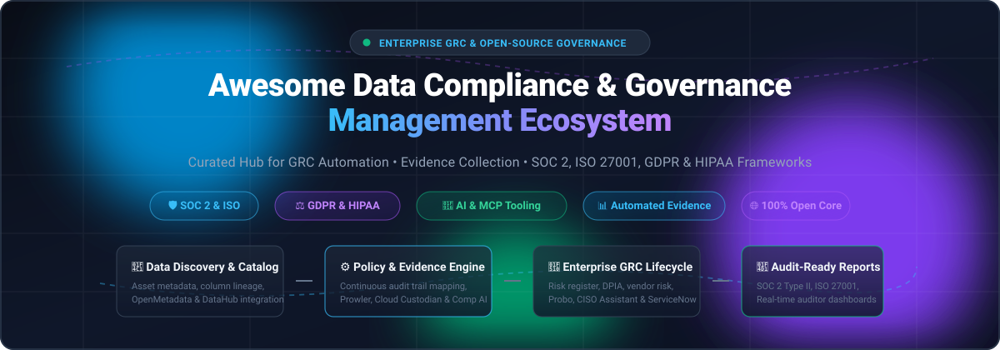

  

# Awesome Data Compliance & Governance Management 🛡️📊

  
  
  
  
  
  
  

---

## 🌟 Top Data Compliance & Governance Management Ecosystem

> **Curated directory of enterprise SaaS platforms and battle-tested open-source GitHub projects for automated GRC, evidence collection, and regulatory framework mapping across SOC 2, ISO 27001, GDPR, HIPAA, and PCI DSS.**  
> *Last updated: March 2026*

This repository tracks the leading **SaaS platforms** and **open-source tools** engineered for **Data Compliance, Governance, Risk, and Compliance (GRC) Management**. These platforms empower organizations to map security controls to regulatory standards, automate continuous audit evidence collection, streamline vendor risk assessments (TPRM), maintain data catalogs with lineage, and produce audit-ready documentation without friction.

Key industry solutions include market leaders like **OneTrust**, **AuditBoard**, **LogicGate**, **MetricStream**, **ServiceNow GRC**, **Archer**, and **Diligent HighBond**, as well as prominent open-source alternatives like **OpenMetadata**, **Prowler**, **Bytebase**, **DataHub**, **Cloud Custodian**, **CISO Assistant**, **Comp AI**, and **Probo**.

Whether you are evaluating six-figure enterprise suites or building transparent, self-hosted governance stacks powered by AI agents and Model Context Protocol (MCP), this guide provides clear insights into pricing models, free tiers, company scale, and star-ranked developer tooling.

---

## 📑 Table of Contents
- [📈 Sector Overview & Market Dynamics](#-sector-overview--market-dynamics)
- [🏢 SaaS/Hosted Platforms](#-saashosted-platforms)
- [💻 Open-Source GitHub Projects](#-open-source-github-projects)
- [🤝 How to Contribute](#-how-to-contribute)
- [💖 Support & Sponsorship](#-support--sponsorship)
- [📊 Star History](#-star-history)
- [⚖️ Disclaimer](#️-disclaimer)

---

## 📈 Sector Overview & Market Dynamics

The global **Governance, Risk, and Compliance (GRC)** market is estimated at approximately **$51.4B–$56.7B in 2026** (scaling to over **$100B+** when incorporating adjacent automated compliance, data privacy, and third-party risk tooling), expanding at a compound annual growth rate (CAGR) of 10%–11.5% driven by intensifying global mandates including DORA, NIS2, the EU AI Act, and SEC cybersecurity disclosure rules. 

The sector exhibits a **moderately fragmented** structure: traditional enterprise risk management is concentrated among a handful of multi-billion-dollar giants (**ServiceNow**, **OneTrust**, **Diligent**, and **AuditBoard/Hg**), while the fast-growing mid-market, cloud security compliance, and open-source data governance sectors remain highly fragmented with dynamic, specialized point solutions and emerging agentic workflows.

---

## 🏢 SaaS/Hosted Platforms

| Product | 🏢 Company Scale (Valuation / Revenue) | 📝 Description | 💳 Pricing (Starting) | 🎁 Free Tier / Trial Limits |
|---------|------------------------------------|-------------|-------------------|--------------------------|
| **[ServiceNow GRC](https://www.servicenow.com/)** | ~$103B–$113B Market Cap (Public: NOW) / ~$11B+ Rev | Enterprise default for organizations on ServiceNow. Inherits platform workflow engine, CMDB, and deep enterprise integrations. | Starting at ~$2,400–$3,800/fulfiller/year; entry deployments start at ~$50,000/year | No free tier; demo via sales walkthrough |
| **[OneTrust](https://www.oneTrust.com/)** | $4.5B Valuation / ~$550M ARR | Dominant GRC platform where privacy and third-party risk management (TPRM) are central. Modular architecture across privacy, risk, and ethics. | Starting at ~$8,000/year (single TPRM module); enterprise packages scale to $300,000+/year | No free tier; demo via sales walkthrough |
| **[Diligent HighBond](https://www.diligent.com/)** | ~$4.0B Valuation (Clearlake/Insight) / ~$600M Rev | Integrated GRC platform with Enterprise Risk Management, Audit Management, and Vendor Risk modules. Monitors KPIs, KRIs, and KCIs with threshold alerts. | Starting at ~$23,488/year (median deployment starting tier) | No free tier or trial; guided demo only |
| **[AuditBoard](https://www.auditboard.com/)** | $3.0B+ Valuation (Acquired by Hg) / ~$200M+ ARR | Category leader for internal audit, SOX compliance, and controls management. Connected-risk model ties audit findings, controls, and risks together. | Starting at ~$41,700/year (SOXHUB Professional); multi-module deployments start at ~$148,000/year | No free tier; demo via sales walkthrough |
| **[Druva Compliance Management](https://www.druva.com/)** | $2.0B Valuation / ~$200M+ ARR | Compliance capabilities within Druva's data protection platform. Focused on data resilience, backup compliance, and governance across cloud workloads. | Starting at ~$8/user/month for SaaS governance, or consumption credit tiers | 30-day free trial with full platform evaluation and data protection features |
| **[Archer (Cinven)](https://www.archerirm.com/)** | ~$1.38B Valuation (Acquired by Cinven) / ~$220M Rev | Fixture in banking, insurance, and heavily regulated sectors requiring deep, auditable integrated-risk management. | Starting at ~$100,000/year for baseline enterprise deployments | No free tier; demo via sales walkthrough |
| **[SAI Global (NAVEX / Intertek)](https://www.saiglobal.com/)** | ~$665M Acquisition / ~$180M Rev | Compliance and ethics platform with whistleblowing, policy management, and regulatory compliance content. | Starting at ~$1,200/year baseline setup for entry tier, scaling with headcount | No free tier; demo via sales walkthrough |
| **[MetricStream](https://www.metricstream.com/)** | ~$478M Valuation / ~$150M+ Rev | Enterprise GRC suite for large regulated organizations. Global integrated risk management with AI features layered across modules. | Starting at ~$100,000/year (enterprise engagements frequently scale to $300,000+) | No free tier; demo via sales walkthrough |
| **[LogicGate](https://www.logicgate.com/)** | ~$166M Raised / ~$49M Rev | Mid-market pick for configurable risk workflows without enterprise price tags. No-code workflow builder lets risk teams model custom processes. | Starting at ~$52,600/year (median contract entry tier) | No free tier; demo via sales walkthrough |
| **[Hyperproof](https://hyperproof.io/)** | ~$77M Raised / ~$25M–$40M ARR | Compliance operations platform focused on evidence collection, framework cross-mapping, and audit collaboration. | Starting at ~$12,000/year (core compliance framework baseline) | No free tier; demo via sales walkthrough |
| **[Resolver](https://www.resolver.com/)** | Kroll Portfolio / ~$35M Rev | Risk intelligence platform covering enterprise risk, incident management, compliance, and security analytics. | Starting at ~$10,000/year for baseline module deployments | No free tier; demo via sales walkthrough |

---

## 💻 Open-Source GitHub Projects

| Project | ⭐ Star Badge | 📝 Description |
|---------|------------|-------------|
| **[OpenMetadata](https://github.com/open-metadata/OpenMetadata)** |  | **Open-source data governance and metadata platform** (Apache 2.0). Data discovery, column-level lineage, automated quality checks, no-code profiling, classification, and data contracts. Complements GRC tools by providing a comprehensive data asset inventory. |
| **[Prowler](https://github.com/prowler-cloud/prowler)** |  | **Open-source security and compliance tool for AWS, Azure, GCP, and Kubernetes.** Performs security assessments, audits, incident response, and continuous compliance monitoring against CIS benchmarks, SOC 2, ISO 27001, HIPAA, and GDPR. |
| **[Bytebase](https://github.com/bytebase/bytebase)** |  | **Database governance and CI/CD platform.** Controls how production databases are changed and accessed, with change review, deployment approval, dynamic data masking, and full audit trail across 25+ database engines. |
| **[DataHub](https://github.com/datahub-project/datahub)** |  | **Extensible metadata platform & data catalog for modern data stacks.** Built originally by LinkedIn; provides end-to-end data governance, lineage, impact analysis, access management policies, and compliance metadata tracking. |
| **[Cloud Custodian](https://github.com/cloud-custodian/cloud-custodian)** |  | **Rules engine for cloud security, governance, and compliance.** Lightweight YAML DSL to define policies for AWS, Azure, and GCP resources, enabling automated compliance enforcement, tag auditing, and garbage collection. |
| **[Amundsen](https://github.com/amundsen-io/amundsen)** |  | **Data discovery and metadata engine created by Lyft.** Powers data governance, compliance tagging, and search for data assets across complex data lakes and warehouses. |
| **[CISO Assistant](https://github.com/intuitem/ciso-assistant-community)** |  | **Open-source GRC platform for security teams documenting risks, controls, and framework alignment.** Self-hosted via Docker. Includes structured representations of ISO 27001, NIST CSF, and SOC 2 with reusable control mappings and multi-framework audit reporting. |
| **[Comp AI](https://github.com/trycompai/comp)** |  | **Open-source compliance automation platform alternative to commercial suites.** Targets SOC 2, ISO 27001, HIPAA, and GDPR. Features AI Policy Editor, automated cloud evidence collection (AWS, GCP, Azure), and cross-platform endpoint compliance device agents. |
| **[Probo](https://github.com/getprobo/probo)** |  | **Complete open-source GRC platform covering the full compliance lifecycle.** Self-hostable via Docker with PostgreSQL. Covers risk management, controls, vendor risk assessments, data privacy (DPIA/TIA/SAR), access reviews, audit programs, and 270+ MCP tools for AI agents. |
| **[SimpleRisk](https://github.com/simplerisk/code)** |  | **Established open-source risk management and compliance platform.** Simplifies risk identification, assessment, mitigation planning, and audit compliance tracking across standard cybersecurity and regulatory frameworks. |

💡 **Architectural Guide for Custom Systems**: Combine **Probo** for full GRC lifecycle management with AI-agent access, **CISO Assistant** for security-focused control mapping to ISO/NIST/SOC 2, **Comp AI** for automated evidence collection, and **Prowler** / **Cloud Custodian** for cloud security posture and compliance scanning. For data cataloging and compliance lineage feeding your GRC program, **OpenMetadata** and **DataHub** provide the governance metadata layer.

---

## 🤝 How to Contribute

Contributions are welcome and appreciated! To propose a new SaaS product, open-source tool, or correction:

1. 🍴 **Fork the repo.**
2. 🌿 **Create a feature branch:** `git checkout -b feature/new-compliance-tool`
3. ✏️ **Add/edit entries in `README.md`:** Ensure SaaS listings include specific pricing and trial limits, and open-source tools include social star badges.
4. 🚀 **Submit a Pull Request (PR)** with a concise summary of the addition or update.

Please keep descriptions objective, factual, and backed by official sources.

---

## 💖 Support & Sponsorship

If you find this curated ecosystem list helpful for your audit preparations, compliance architecture, or security engineering work, please consider supporting the project:

- ⭐ **Star this repository** to help others discover it!
- 🍴 **Fork and share** it with your engineering and compliance teams.
- ☕ **Buy a coffee or sponsor ongoing maintenance**: Support via the [GitHub Sponsor Dashboard](https://github.com/sponsors/ishandutta2007).

Your support keeps this repository actively updated with the latest tools and pricing insights! 🙏

---

## 📊 Star History

---

## ⚖️ Disclaimer

- This is a **community-curated** list — not exhaustive and not an endorsement.
- GRC platforms handle audit evidence, risk registers, and regulatory documentation; always enforce role-based access, immutable audit logs, and compliance with applicable data protection regulations.
- **Enterprise GRC pricing is genuinely six-figure territory.** MetricStream and Archer are enterprise engagements at **$100K–$300K+**. ServiceNow GRC scales per-fulfiller to **$580K–$1.6M** at 100–250 fulfillers. Even mid-market LogicGate has a median deployment of **~$52,600**. 
- **Open-source GRC has matured to the point of genuine viability.** Probo covers the full lifecycle with AI-agent integration, CISO Assistant provides structured framework mapping, and Comp AI directly targets commercial compliance use cases with automated evidence and device agents. However, open-source GRC tools require self-hosting effort and do not provide the audit-firm relationships or pre-built auditor acceptance that commercial platforms offer. Validate control mappings and evidence quality against your auditor's expectations before relying on any tool for compliance certification.

---

  <b>Built for compliance officers, risk managers, internal auditors, and security engineers.</b> 
  Let's make data compliance and governance more open, automated, and audit-ready!

